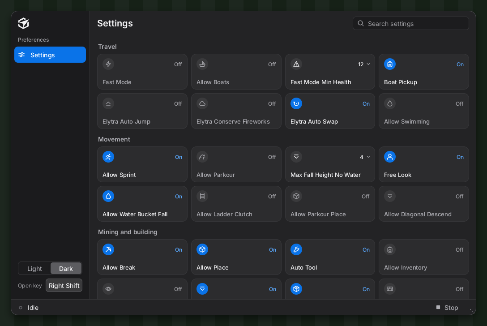
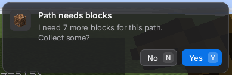
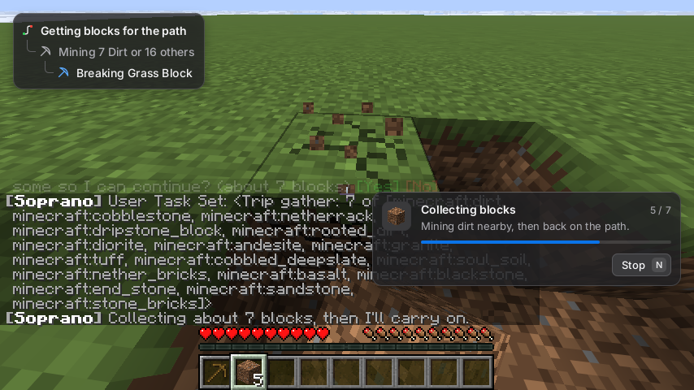

### What's new since v1.1.7-nightly.9

**A new settings page**

- Settings are a grid of tiles now, with plain names and a tooltip on each. The first page has the 40 settings people actually use, in six sections. Switches flip on click, everything else opens a small popup (1794e56, da59535)
- The search at the top goes through every setting: the name on the tile, the real name, old names and the tooltip text
- **Show all settings** lists every setting by category, with a **Reset all** that asks first
- The old `#set` names still work, nothing to relearn

**A command bar and a Commands tab**

- The Stats and Help tabs are gone. Stats never worked, and the useful part of Help, the command line, is now a bar at the bottom of the panel on every tab. Enter runs, up/down goes through what you typed before (79cbf13)
- New Commands tab: save a list of commands as a routine and run it. Steps are get, equip, go to, wait or any command, and a step only moves on once the one before it really finished. Closing the menu doesn't stop a running routine (40b850d)
- The item, block, mob and player boxes in the Commands tab suggest ids as you type (d0b9048)
- There's also a node editor for routines with branches and loops. It's hidden for now: turn on `experimentalRoutineGraphs` if you want to try it (f213515)

**Trip question in a corner toast**

- When a path needs blocks, a "Path needs blocks" toast pops up bottom right. Answer with Y or N, or click it with chat open. Y and N can be rebound under Soprano in Controls (a4b6791)
- While it collects you get "Collecting blocks n/m" with a bar and a Stop button (N), then "Got m blocks"
- The [Yes] / [No] line in chat is still there as a fallback

**Task panel**

- What the bot is doing shows top left as a glass panel: a small tree of tasks with icons and a progress bar, and a short Idle pill when it stops (57e8885)
- It stays out of the way of the toast, chat, boss bars and the `#gamer` card, and hides on F1 / F3 (6eab703, 32e3892)

**Bot fixes**

- After beating the game the bot no longer closes the credits early. That used to leave you standing in the End. In a test the credits stayed up the whole time. Going home after them is vanilla, and the test ended before the credits did, so that part wasn't seen (fcd0a9c)
- NeoForge starts again. NeoForge players on nightly.9 already got a fixed jar, this carries the fix on. On NeoForge the bot starts swimming a little slower (8ed9bea)

**#gamer is still being worked on**

No new `#gamer` fixes in this one besides the credits. Wins still aren't reliable.

**Good to know**

- This is a nightly. Expect bugs
- `#gamer` is still being worked on and isn't reliable yet
- The toast and task panel were checked in test games with screenshots, and the game starts to the title screen on Fabric, Forge 66.1.5 and NeoForge 26.3.0.101. They weren't played by hand on Forge or NeoForge yet
- The settings picture is a preview render of the page. The real menu has more tabs on the left and the command bar at the bottom
- If a run stops and says so, type `#gamer` and it picks back up
- Every test above ran on the 26.3 build. This Any Version build passed its build and tests and shares the same 26.3 code, it had no test games of its own
