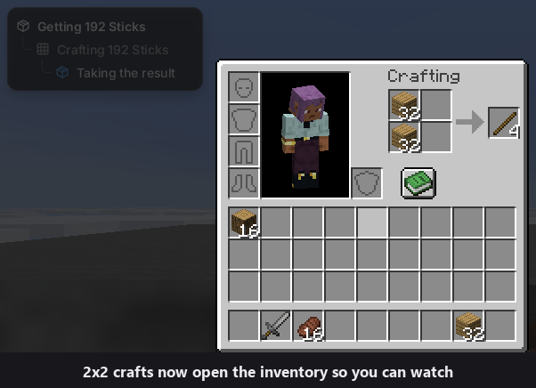

### What's new since v1.1.7-nightly.11

**Watch it craft**

- When the bot crafts in the small 2x2 grid, your inventory now opens so you can see it working, and closes again half a second after the craft. Before, it clicked the grid with no screen up and looked like it was just standing there (2071e32)
- It shuts right away when the bot has to eat, fight, block or get out of danger, and it never opens over a screen you have open, while you hold a key, or in creative
- Back to back crafts keep the screen up instead of closing and reopening it every craft (8c66cff)
- Turn it off with "Show Inventory When Crafting" on the first settings page, under Mining and building. It's on by default
- To make room, "Build In Layers" moved off the first settings page. It's still there under Show all

**#gamer: boats and water**

- `#gamer` now carries a boat and rows across oceans while it looks for the stronghold, instead of swimming a thousand blocks next to trident drowned. It crafts one boat (5 planks) when it makes its iron gear and carries it through the Nether. Boats are only turned on while it looks for the stronghold and digs to it, your own "Allow Boats" setting comes back after (94a0727)
- If the stronghold is under the sea, it now goes to the nearest shore within 100 blocks, digs down and tunnels under the sea floor to it (94a0727)
- In the water it no longer stops to heal, and it doesn't think a run from drowned is over while they are still throwing tridents. When it can't see land within 32 blocks it looks out to 64 (ea5aa56)

**#gamer: Nether magma cubes**

- A magma cube hopping toward the bot on a lava edge now gets the shield up early, so its first hit is much less likely to knock the bot into the lava (f014ec7)
- While it blocks a cube on a lava edge it also hits back, so the cube dies instead of the bot standing there until it gets knocked. It never holds the shield on an edge for more than 10 seconds at a time (fe21a5c)
- The smallest magma cubes now count as a threat, they bite and knock too. At low health a tiny cube is still a quick fight, not a reason to run (17eeccd)
- In a test setup with magma cubes on lava edges, lava deaths went from 12 to 5

**#gamer: other fixes**

- With no sword or axe it makes a wooden sword first, even when it thinks it has enough food. Food still cooking in a furnace made it think it was fed and walk off unarmed (2b4663c)

**Good to know**

- This is a nightly. Expect bugs
- `#gamer` is still being worked on and isn't reliable yet. In one test game it got through the whole Nether with no deaths, then died to drowned while crossing an ocean on the way to the stronghold. That was before the boat and water fixes. A test game with the boats crossed water by boat 3 times while looking for the stronghold and got to the dragon fight in the End before its time ran out. The latest test game died to blaze fire 29 minutes in, in the Nether, and was still rebuilding to go back when its 100 minutes ran out
- The dig under the sea to a stronghold below an ocean hasn't happened in a test game yet
- A trident breaks a boat in one hit. The bot swims, picks the boat back up and keeps going. If the boat is lost for good, it doesn't craft another one and swims instead
- The craft screen was checked in test worlds, not yet in a full game
- The boat game above ran on this Any Version build, the other test games ran on the 26.3 build. This build passed its build and tests and shares the same code
- Nothing in this nightly changes how the mod loads
- If a run stops and says so, type `#gamer` and it picks back up
