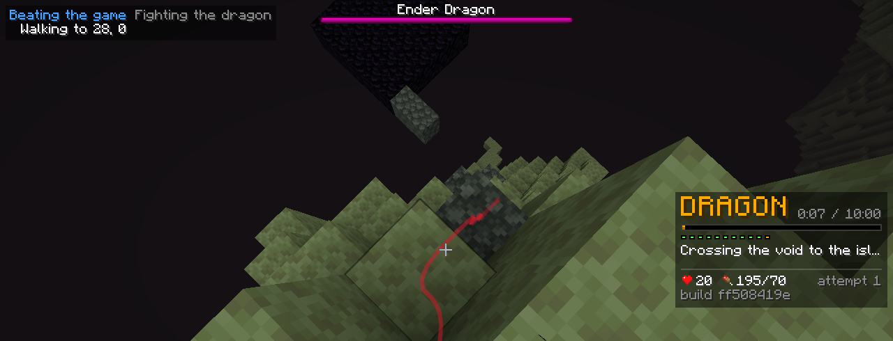
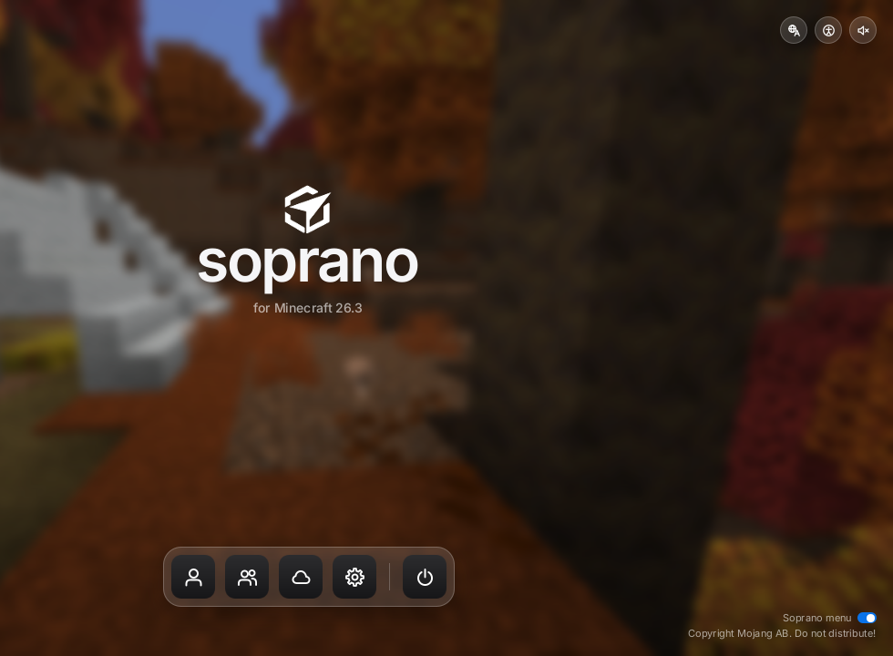
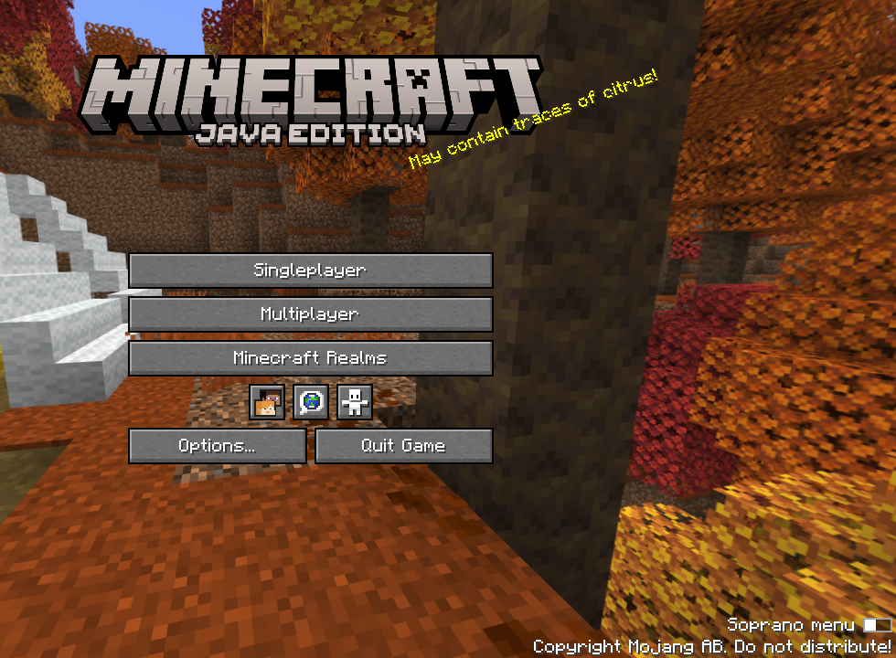

### What's new since v1.1.7-nightly.4

**#gamer beat the game once in testing**

First full `#gamer` win in testing: fresh world to the credits in 2 h 21 min with 0 deaths. That's one win so far, it's still not reliable, see Good to know at the bottom

**The dragon**

- The original pillar bed fight is back and it's now THE fight: waits at the bedrock pillar, puts a bed on top as the dragon comes in and clicks it while the head is close. The floor bed fight is gone (15a34aa)
- Leaves the crystals alone during the bed fight. Only falls back to the sword when the beds are really gone (15a34aa)
- Gathers 9 beds before the End and doesn't go in short: crafts from wool, breaks any known bed like a village's, otherwise finds sheep (9372c14)
- Only mines end stone when it needs a floor to stand on, and only right around it (15a34aa, 0cbbf1d)

**Getting to the End**

- Does its End prep on the surface before digging down, so no more climbing back up for beds and a pick after opening the portal (b7a91a8)
- Doesn't idle at the portal ring any more, the walk finishes as soon as it arrives (fc61759)
- The stronghold walk stops throwing its path away every few seconds (d35a45f)
- Doesn't pick a pond sitting on the End portal for a bucket, the water used to land on the spawn platform with the bot in it (3cab367)

**Wandering, food and wood**

- The endless wander knows land from ocean: heads for unseen chunks next to land, only crosses water on purpose, and swims back if it ends up out at sea (5ed7cc7)
- A station placed from the water swims back to dry land first (daa9e65)
- The food hunt no longer flip-flops, it keeps going until the food line holds without counting the raw meat (e36ab21)
- Mineshaft support logs aren't trees anymore (2bd46b9)
- Keeps its furnace and smoker instead of throwing them out for space, and lets go of a lost crafting table drop (daa9e65)

**Nether safety**

- Holds sneak on magma when it's off the ground, and a ladder over magma no longer freezes the bot (d81859d, ff50841)
- Won't wake still lava by placing a block next to it, and won't plan a drop that lands right next to lava (fd0fa6e, 84cd994, 7e71877)
- A blaze that burns the bot is now a target, even in the middle of another fight (262a7c3)
- A shield doesn't freeze a fight any more, and "cornered" can actually end (262a7c3)
- Keeps sneak when hanging off a ledge, and gives up on a bridge that's stuck over a drop instead of riding it into a fall (28a6a5e, b8adf9e)
- Hides in a hole from ghasts before healing, and sees fireballs coming sooner (00ab5c9)
- Builds a stair out of lava against walls up to four high (5174b86)
- Eats a gapple when burning at low health (551fbfc)

**Pearls and piles**

- The pearl hunt roams the warped forest instead of walking out of it, and grabs close pearls first (a947a6d)
- Hits an angry enderman the tick it gets into reach (a76fff3)
- A death pile gets its valuables picked up first, and a pearl can push out a lone stack of junk (28a6a5e, f8f9a53)

**Main menu**

- New "Soprano menu" toggle at the bottom right of the title screen. On by default, off gives you the vanilla menu, and it stays that way after a restart (7743e28)

**Good to know**

- This is a nightly. Expect bugs
- `#gamer` is still being worked on and isn't reliable yet. It has beaten the game once in testing, that doesn't mean it will in your world
- Getting through the first Nether trip worked in 6 of 9 test games on recent code, not counting one lava lake world
- It can still die in the Nether (lava, ghast fireballs, wither skeletons) and to the dragon
- The bed search has no time limit. In a world short on beds, wool and sheep it keeps looking, and says so in the log every 5 minutes
- If a run stops with "no progress", type `#gamer` and it picks back up
